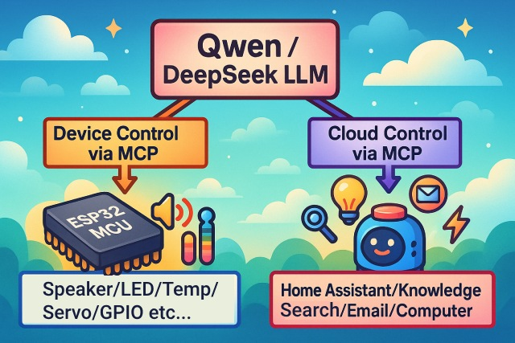
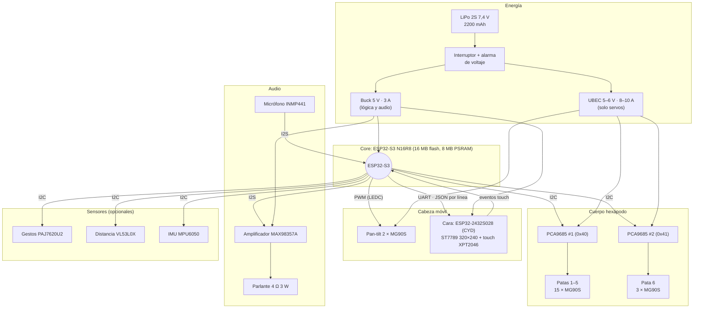
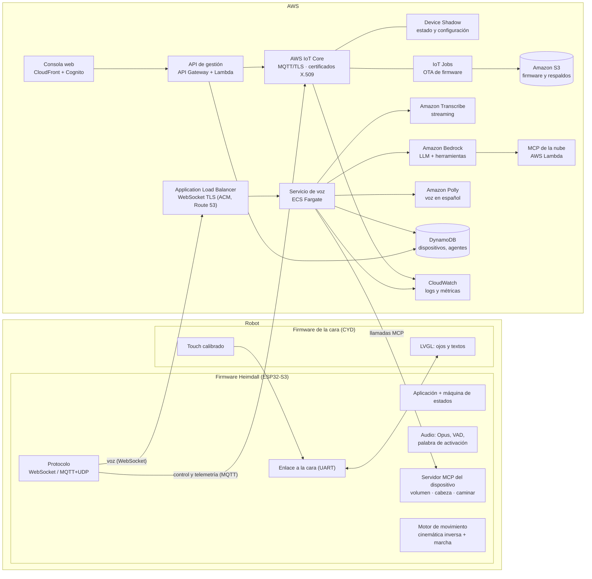

# Heimdall

Asistente de voz con IA sobre ESP32 que evoluciona hacia un **robot de escritorio**: una cara táctil con ojos animados, una cabeza móvil y un cuerpo hexápodo de 6 patas, todo controlado por voz mediante el protocolo **MCP** (Model Context Protocol).



## Estado del proyecto

| Etapa | Estado |
|---|---|
| Asistente de voz en la ESP32-2432S028 (CYD): pantalla, touch, WiFi, servidor propio | ✅ Funcionando |
| Consultas de texto por puerto serie (sin micrófono) y control del dispositivo por voz/texto | ✅ Funcionando |
| Cara del robot en la CYD: ojos animados, expresiones, touch calibrado, enlace UART | ✅ Funcionando |
| Core ESP32-S3: micrófono, parlante, palabra de activación, cara remota | ⏳ Compra A |
| Cabeza móvil (pan-tilt de 2 servos) | ⏳ Compra A |
| Hexápodo de 18 servos: cinemática inversa, marcha trípode, control por voz | ⏳ Compra B |
| Migración del servidor a AWS IoT (ver [Migración a AWS](#migración-a-aws)) | 📋 Planificada |

**Versión actual: 0.2.0** ([CHANGELOG](CHANGELOG.md), [releases](https://github.com/eruizpy/heimdall/releases)). El detalle del avance, las decisiones y la bitácora están en [docs/heimdall/PROGRESS.md](docs/heimdall/PROGRESS.md); las especificaciones de cada funcionalidad, en [docs/specs](docs/specs/README.md).

## Puesta en marcha rápida

Cada [release](https://github.com/eruizpy/heimdall/releases) trae un paquete para **macOS** y otro para **Linux** con los firmwares listos para grabar en la ESP32-2432S028, el script de grabación (no necesita ESP-IDF), las herramientas de prueba y el instalador del entorno de desarrollo.

```sh
# 1. Descargar y descomprimir (o bajarlo desde la página de releases)
gh release download v0.2.0 --repo eruizpy/heimdall --pattern "*-macos.tar.gz"   # o *-linux.tar.gz
tar -xzf heimdall-v0.2.0-macos.tar.gz && cd heimdall-v0.2.0-macos

# 2. Grabar la placa (crea su propio entorno Python con esptool)
./flash.sh assistant          # asistente de voz
./flash.sh face               # cara del robot

# 3. Probar sin micrófono
.venv/bin/python tools/heimdall_ask.py "Hola"
.venv/bin/python tools/heimdall_face.py demo

# 4. Entorno de desarrollo completo (dependencias, ESP-IDF v6.1, clang-format, repo, hook)
./setup-dev.sh
```

- Después de grabar el asistente: conectarse a la red `Heimdall-XXXX`, abrir `http://192.168.4.1`, elegir el WiFi de 2,4 GHz y cargar en **"Custom OTA URL"** la URL de OTA del servidor (consola → Parámetros → `server.ota`). Los firmwares publicados no traen ningún servidor propio configurado.
- Grabar con `flash.sh` deja la placa como nueva: se borran el WiFi guardado y la calibración del touch.
- Desde un clon del repositorio, el entorno se prepara con `tools/setup-macos.sh` o `tools/setup-linux.sh` (`--dry-run` muestra los pasos).

## Funcionalidades

- Conversación por voz en streaming (Opus) con la cadena ASR → LLM → TTS; respuesta en ~2 s.
- Dos transportes: [WebSocket](docs/websocket.md) y [MQTT + UDP](docs/mqtt-udp.md), con TLS.
- **MCP del lado del dispositivo**: el modelo controla el hardware (volumen, brillo, servos, movimiento).
- **MCP del lado de la nube** para ampliar capacidades (domótica, búsquedas, servicios externos).
- Palabra de activación offline en chips con PSRAM (ESP32-S3); botón o toque en la pantalla en el resto.
- Pantallas LCD/OLED con expresiones; cara robótica propia con ojos animados.
- Configuración WiFi por punto de acceso (`Heimdall-XXXX`) y actualizaciones OTA.
- Interfaz y voz en español; soporte para más de 30 idiomas.
- Chips: ESP32, ESP32-C3, ESP32-C5, ESP32-C6, ESP32-S3 y ESP32-P4.

## Arquitectura de hardware



- Los servos tienen alimentación propia (UBEC) y comparten la tierra con la lógica, para que los picos de corriente no reinicien la placa.
- La CYD va montada sobre el pan-tilt: la pantalla es la cabeza que gira y mira.
- El protocolo entre la cara y el core está en [docs/heimdall/face-protocol.md](docs/heimdall/face-protocol.md).

## Arquitectura de software

Visión de referencia del sistema desplegado sobre **AWS IoT**:



| Capa | Responsabilidad |
|---|---|
| **AWS IoT Core** | Identidad del dispositivo (certificados X.509), mensajes MQTT de control y telemetría, reglas hacia otros servicios. |
| **Device Shadow / IoT Jobs** | Estado deseado (volumen, brillo, modo) y despliegue de firmware OTA desde S3. |
| **Servicio de voz (ECS Fargate)** | Sesiones WebSocket del dispositivo: orquesta ASR, LLM y TTS y despacha las herramientas MCP. |
| **Transcribe / Bedrock / Polly** | Reconocimiento de voz, modelo de lenguaje con herramientas y síntesis de voz en español. |
| **Lambda (MCP de la nube)** | Herramientas externas: clima, domótica, búsquedas. |
| **Consola (CloudFront + Cognito + API Gateway)** | Alta de dispositivos, agentes y personalidad; usuarios autenticados. |
| **DynamoDB / S3 / CloudWatch** | Datos de dispositivos y agentes, firmware y respaldos, observabilidad. |

## Migración a AWS

Hoy el servidor corre en contenedores sobre una máquina virtual ([deploy/vps](deploy/vps/README.md)). La migración lleva esa operación a la arquitectura de referencia de arriba, por fases y sin cortar el servicio: cada fase se valida con un dispositivo de prueba antes de mover el resto.

**Región: `us-east-1` (N. Virginia).** Tiene disponibles todos los servicios del diseño (AWS IoT, Bedrock, Transcribe y Polly con español), así que se prioriza la cobertura sobre la menor latencia de `sa-east-1`.

### Productos de AWS involucrados

| Área | Producto | Uso en Heimdall |
|---|---|---|
| Conectividad | **AWS IoT Core** (broker MQTT, MQTT 5) | Canal de control y telemetría con TLS mutuo |
| Identidad | **Certificados X.509 + políticas de AWS IoT** | Un certificado por dispositivo, permisos mínimos por tópico |
| Alta de dispositivos | **AWS IoT Fleet Provisioning** (por certificado de reclamo) | El dispositivo obtiene su certificado definitivo en el primer arranque |
| Estado | **AWS IoT Device Shadow** | Configuración deseada y reportada: volumen, brillo, modo, agente |
| Actualizaciones | **AWS IoT Jobs + AWS IoT OTA** con **AWS Signer** | Firmware firmado en S3, despliegue gradual con criterios de aborto |
| Reglas | **AWS IoT Rules Engine** | Telemetría hacia DynamoDB, CloudWatch y Lambda |
| Flota | **AWS IoT Device Management** (Fleet Indexing, Secure Tunneling) | Búsqueda de dispositivos por estado y acceso remoto para soporte |
| Seguridad | **AWS IoT Device Defender** | Auditoría de políticas y certificados, detección de comportamiento anómalo |
| Credenciales | **AWS IoT Credentials Provider** | Credenciales temporales para que el dispositivo acceda a S3 sin claves fijas |
| Firmware | **esp-aws-iot** (coreMQTT, Shadow, Jobs y OTA para ESP-IDF) | Bibliotecas oficiales integradas en el firmware |
| Voz | **Amazon Transcribe** (streaming), **Amazon Bedrock**, **Amazon Polly** | ASR, LLM con herramientas MCP y voz neural en español |
| Cómputo | **Amazon ECS en Fargate** + **Application Load Balancer** | Servicio de voz por WebSocket con TLS |
| Plataforma | **Route 53, ACM, Cognito, CloudFront, API Gateway, Lambda, DynamoDB, S3, Secrets Manager, CloudWatch** | DNS y certificados, consola y su API, datos, secretos y observabilidad |
| Infraestructura | **AWS CDK** + **AWS Budgets** | Infraestructura como código y alertas de costo |

### Fases de trabajo

| Fase | Trabajo | Entregable / criterio de aceptación |
|---|---|---|
| **0. Preparación** | Cuenta y accesos (IAM Identity Center), repositorio de infraestructura con CDK, alertas de presupuesto; todo en la región **`us-east-1`** | `cdk deploy` crea un entorno vacío en `us-east-1`; alertas activas |
| **1. Identidad y conexión** | Tipo de cosa y políticas de AWS IoT; Fleet Provisioning; en el firmware, **esp-aws-iot** con certificado guardado en la partición `esp_secure_cert` y, en la ESP32-S3, **Secure Boot v2 + cifrado de flash** | El dispositivo se aprovisiona solo y conecta a AWS IoT Core por MQTT con TLS mutuo |
| **2. Estado y control** | Shadow con volumen, brillo, modo y agente; Rules Engine hacia DynamoDB y CloudWatch; Fleet Indexing | Cambiar el volumen desde la consola se refleja en el dispositivo y queda en el estado reportado |
| **3. OTA** | Perfil de firma con AWS Signer, firmware en S3, AWS IoT Jobs con despliegue gradual y aborto automático; validación y *rollback* en el firmware | Un firmware firmado llega a un grupo de prueba; uno sin firma o defectuoso se rechaza o vuelve atrás |
| **4. Voz** | Servicio de voz en ECS Fargate detrás de un ALB con WebSocket; autenticación del dispositivo con token emitido vía AWS IoT; Transcribe (streaming), Bedrock con herramientas MCP y Polly; claves externas, si se mantiene un proveedor, en Secrets Manager | Conversación completa en español con primera respuesta en ≤ 3 s y control del dispositivo por voz |
| **5. Consola y datos** | Consola web en CloudFront + S3 con Cognito; API Gateway + Lambda; tablas de DynamoDB; script que migra dispositivos, agentes y configuración desde la base actual | La consola nueva administra dispositivos y agentes; los datos migrados coinciden con los originales |
| **6. Seguridad y operación** | Device Defender (auditoría y detección), alarmas y paneles de CloudWatch, recuperación a un punto en el tiempo de DynamoDB, revisión de costos | Alarmas probadas, auditoría sin hallazgos críticos, costo mensual dentro del presupuesto |
| **7. Corte** | Ambos entornos en paralelo; un OTA final apunta los dispositivos a AWS; monitoreo; se apaga la máquina virtual con un respaldo final | Todos los dispositivos operan en AWS durante una semana sin incidentes |

### Cambios en el firmware

- **Transporte:** el firmware ya soporta MQTT + UDP. El canal de control pasa a AWS IoT Core (coreMQTT) con tópicos por dispositivo; el audio sigue por WebSocket hacia el servicio de voz.
- **Arranque:** hoy la URL de OTA entrega la configuración. En AWS, la configuración llega por el Shadow y las actualizaciones por Jobs.
- **Seguridad:** certificado único por dispositivo, nunca compilado dentro del firmware; en la ESP32-S3, Secure Boot v2, cifrado de flash y el periférico de firma digital para proteger la clave privada.
- **Compatibilidad:** las herramientas MCP del dispositivo (volumen, cabeza, movimiento) no cambian; solo cambia quién las invoca.

## Componentes

### Ya disponible

| Componente | Uso |
|---|---|
| ESP32-2432S028 "CYD2USB" (ESP32, ST7789 2,8", touch XPT2046) | Asistente actual y futura cara del robot |

### Compra A: voz y cabeza móvil (USD 105–141)

| Producto | Cant. | Aprox. | Verificar |
|---|---|---|---|
| ESP32-S3 DevKitC-1 **N16R8** | 1 | USD 15–20 | N16R8 (16 MB flash + 8 MB PSRAM), USB-C |
| Micrófono INMP441 I2S | 1 pack | USD 8–12 | INMP441 |
| Amplificador MAX98357A I2S | 1 pack | USD 8–12 | MAX98357A, 3 W |
| Parlante 4 Ω 3 W | 1–2 | USD 8–10 | 4 Ω, 3 W |
| Servos **MG90S** | 1 pack de 10 | USD 25–30 | Engranaje metálico (2 para la cabeza, 8 para pruebas) |
| Soporte pan-tilt para servos 9G (SG90/MG90S) | 1 | USD 8–12 | Para micro servos; sin servos incluidos está bien |
| Fuente 5 V 3 A (plug 5,5×2,1) + adaptador a bornera | 1 + 1 | USD 10–15 | 5 V, 3 A |
| Capacitores electrolíticos 1000 µF | 1 surtido | USD 6–8 | ≥ 16 V |
| Cable JST 1,25 mm de 4 pines | 1 pack | USD 7–10 | 1,25 mm (conector CN1 de la CYD) |
| Kit protoboard + cables dupont | 1 | USD 10–12 | Macho-macho, macho-hembra, hembra-hembra |
| *Si no hay:* soldador + multímetro | 1 | USD 25–45 | Los módulos vienen con pines sin soldar |
| *Opcional:* sensor de gestos PAJ7620U2 | 1 | USD 8–12 | |

### Compra B: hexápodo, solo lo faltante (USD 164–234)

| Producto | Cant. | Aprox. | Verificar |
|---|---|---|---|
| Servos **MG90S** | 2 packs de 10 (30 en total) | USD 50–60 | Engranaje metálico |
| Driver de servos PCA9685 | 2 | USD 10–14 | 16 canales, I2C |
| Batería LiPo 2S 7,4 V 2200 mAh XT60 | 1 | USD 25–35 | ≥ 25C |
| Cargador balanceador LiPo | 1 | USD 25–50 | Soporta 2S |
| UBEC 5/6 V de 8–10 A | 1 | USD 12–20 | ≥ 8 A |
| Buck 5 V 3 A | 1 | USD 8–10 | Entrada hasta 12 V |
| Alarma de voltaje LiPo | 1 | USD 6–8 | 1S–8S |
| Conectores XT60 + interruptor | 1 kit | USD 8–12 | ≥ 10 A |
| Alargues de servo | 1 pack | USD 8–10 | 15–30 cm |
| Kit de tornillos M2/M3 | 1 | USD 12–15 | Con tuercas y separadores |
| *Opcionales:* distancia VL53L0X, IMU MPU6050 | 1 c/u | USD 16–20 | |

**Total estimado:** USD 269–375, más piezas impresas en 3D (filamento USD 20–25 o impresión por encargo USD 40–100) y envío. Las baterías LiPo suelen tener restricciones de envío internacional: conviene comprar batería y cargador localmente. Lista con enlaces de búsqueda: [docs/heimdall/compras.md](docs/heimdall/compras.md).

## Estructura del repositorio

| Ruta | Contenido |
|---|---|
| `main/` | Firmware principal: aplicación, audio, protocolos, pantallas, MCP y placas |
| `main/boards/esp32-2432s028/` | Placa CYD2USB: pantalla, touch como botón, audio por DAC + INMP441 |
| `face/` | Firmware de la cara del robot para la CYD (proyecto ESP-IDF aparte) |
| `deploy/vps/` | Servidor actual en contenedores: compose, proxy HTTPS, respaldos |
| `scripts/build.py` | Compilación por placa y variante |
| `scripts/heimdall_ask.py` | Enviar preguntas de texto al asistente por puerto serie |
| `scripts/heimdall_face.py` | Simular al core frente a la cara (demo, monitor, comandos) |
| `scripts/ci.sh` | CI local: tests, formato y compilación de los firmwares |
| `scripts/package_release.py` | Arma los paquetes de release para macOS y Linux en `dist/` |
| `tools/` | Grabación sin ESP-IDF (`flash.sh`), instaladores del entorno (`setup-macos.sh`, `setup-linux.sh`) y guía del paquete |
| `.githooks/` | Hook de pre-push que corre el CI rápido |
| `docs/heimdall/` | Progreso, compras y protocolo de la cara |
| `docs/specs/` | Especificaciones (SDD): requisitos, plan y tareas por funcionalidad |
| `tests/host/` | Tests de la lógica del firmware que corren en la computadora |

## Desarrollo

Requisitos: ESP-IDF **v6.1** (rama `release/v6.1`; mínimo v6.0.1), Python 3, `cmake`, `ninja`. Funciona en Linux y macOS.

```sh
. ~/esp/esp-idf-v6.1/export.sh

# Firmware del asistente (la URL del servidor no se guarda en el repo)
export HEIMDALL_OTA_URL=<url-ota-del-servidor>
python3 scripts/build.py esp32-2432s028 --name esp32-2432s028 --language es-ES

# Firmware de la cara
cd face && idf.py set-target esp32 && idf.py -p <puerto> flash

# CI local: tests (Unity + unittest), formato y los dos firmwares; --quick omite la compilación
scripts/ci.sh
scripts/ci.sh --quick

# Activar el hook de pre-push (una vez por clon)
git config core.hooksPath .githooks
```

El proyecto sigue un ciclo **SDLC con SDD y TDD**: cada funcionalidad tiene especificación, plan y tareas en [docs/specs](docs/specs/README.md) y los tests se escriben antes que el código. El CI es **local** (sin GitHub Actions): `scripts/ci.sh` corre tests, formato y compilación de los dos firmwares, y el hook de pre-push corre la versión rápida (activarlo una vez por clon con `git config core.hooksPath .githooks`). Cambios por versión en [CHANGELOG.md](CHANGELOG.md).

Publicar una versión (firmwares sin URL propia, paquetes y checksums en `dist/`):

```sh
unset HEIMDALL_OTA_URL
python3 scripts/package_release.py --version X.Y.Z
gh release create vX.Y.Z dist/*.tar.gz dist/SHA256SUMS --title "Heimdall vX.Y.Z" --notes-file <notas>
```

Probar sin micrófono:

```sh
python3 scripts/heimdall_ask.py "¿Qué hora es?"     # asistente (firmware principal)
python3 scripts/heimdall_face.py demo               # cara (firmware face/)
```

Puertos serie: `/dev/cu.usbserial-*` en macOS, `/dev/ttyUSB*` en Linux.

## Documentación

- [Progreso y decisiones](docs/heimdall/PROGRESS.md)
- [Proceso de desarrollo y especificaciones](docs/specs/README.md)
- [Changelog](CHANGELOG.md)
- [Compras](docs/heimdall/compras.md)
- [Protocolo cara ↔ core](docs/heimdall/face-protocol.md)
- [Servidor y respaldos](deploy/vps/README.md)
- [Guía de placas personalizadas](docs/custom-board.md)
- [Protocolo MCP](docs/mcp-protocol.md) · [Uso de MCP](docs/mcp-usage.md)
- [Protocolo WebSocket](docs/websocket.md) · [Protocolo MQTT + UDP](docs/mqtt-udp.md)

## Licencia

MIT. Ver [LICENSE](LICENSE).
