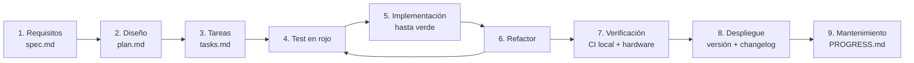

# Proceso de desarrollo de Heimdall (SDLC con SDD y TDD)

Cada funcionalidad recorre el mismo ciclo. Nada se implementa sin especificación aprobada, y nada se da por terminado sin tests en verde.

## 1. SDD: especificación antes que código

Cada funcionalidad tiene una carpeta `docs/specs/NNN-nombre/` con tres archivos (plantillas en [`_template/`](_template/)):

| Archivo | Contenido | Quién lo aprueba |
|---|---|---|
| `spec.md` | Problema, alcance, requisitos funcionales (RF) y no funcionales (RNF), **criterios de aceptación** verificables (CA) | El dueño del producto (eruizpy) |
| `plan.md` | Diseño: módulos, interfaces, decisiones y alternativas descartadas, riesgos | Revisión técnica |
| `tasks.md` | Tareas chicas y ordenadas; cada una nombra el test que la verifica | — |

Estados de una especificación: **Borrador → Aprobada → Implementada → Verificada**. Una especificación aprobada solo cambia con una nota en su historial.

## 2. TDD: test primero

Para cada tarea: escribir el test que falla (**rojo**), el código mínimo que lo hace pasar (**verde**) y después mejorar el código sin romper tests (**refactor**). En firmware, la lógica se separa del hardware para poder testearla en la computadora.

| Nivel | Qué cubre | Dónde | Cómo se corre |
|---|---|---|---|
| Unitarios de firmware | Lógica pura en C/C++: protocolos, cálculos, mapeos, cinemática | `tests/host/` (Unity) | `cmake -S tests/host -B build-host && cmake --build build-host && ctest --test-dir build-host` |
| Unitarios de herramientas | Scripts de Python y sistema de compilación | `scripts/tests/` (unittest) | `python3 -m unittest discover -s scripts/tests` |
| Compilación | Que cada firmware compile | `scripts/ci.sh` | `scripts/build.py` y `idf.py build` |
| Hardware en el circuito (HIL) | El firmware real responde por puerto serie | `scripts/heimdall_face.py`, `scripts/heimdall_ask.py` | Con la placa conectada |
| Manual en hardware | Lo que no se automatiza: pantalla, audio, movimiento | Checklist del `spec.md` | Registro en `PROGRESS.md` |

Regla: el código que toca hardware queda lo más fino posible; toda decisión (cálculo, validación, formato, estado) va a un módulo puro con tests.

## 3. Definición de terminado

Una tarea o funcionalidad está terminada cuando:

1. La especificación está **Aprobada** y sus criterios de aceptación se cumplen.
2. Los tests nuevos se escribieron antes del código y están en verde, igual que los existentes.
3. El CI local termina en `CI OK`: `scripts/ci.sh` corre tests, formato y compilación de los dos firmwares. El proyecto **no usa GitHub Actions**; el hook `.githooks/pre-push` corre la versión rápida (tests y formato) antes de cada push.
4. Lo que requiere hardware se probó y quedó registrado en `PROGRESS.md`.
5. La documentación (README, specs, protocolos) refleja el cambio.
6. El cambio está en `CHANGELOG.md`; si se publica, con su tag de versión.

## 4. Versionado

[Versionado semántico](https://semver.org/lang/es/) con tags `vMAYOR.MENOR.PARCHE` y [`CHANGELOG.md`](../../CHANGELOG.md). Mientras el proyecto esté en `0.x`, la versión menor sube con cada etapa del robot.

## Especificaciones

| N.º | Funcionalidad | Estado |
|---|---|---|
| [001](001-text-query/spec.md) | Consultas de texto por puerto serie | Verificada (retroactiva) |
| [002](002-robot-face/spec.md) | Cara del robot en la CYD | Verificada (retroactiva) |
| [003](003-server-private-config/spec.md) | Servidor propio y configuración privada | Verificada (retroactiva) |
| 004 | Core ESP32-S3 con voz y cara remota | Por escribir antes de la compra A |
| 005 | Cabeza móvil (pan-tilt) | Por escribir |
| 006 | Hexápodo: cinemática y marcha | Por escribir antes de la compra B |
| 007 | Migración a AWS IoT | Por escribir (base: README, "Migración a AWS") |
| [008](008-release-packages/spec.md) | Paquetes de release para macOS y Linux | Verificada |

Las especificaciones retroactivas documentan lo que ya existía antes de adoptar este proceso; sus tests se agregaron después, siguiendo el ciclo rojo → verde sobre módulos extraídos.
